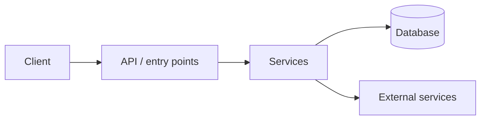
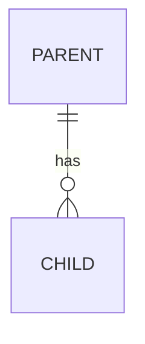

# System Map Template

Used by **map mode** (`/antivibe map`). Layer 1 writes this page; Layer 2 writes one deep dive per module beside it.

```
deep-dive/[project]-map/
├── README.md              # index: start here + one line per module
├── 00-system-map.md       # this template
└── modules/
    ├── 01-[module].md     # full-mode deep dive + "How it connects"
    ├── 02-[module].md
    └── ...
```

---

<!-- Every factual claim cites `path:line`. Write "unverified" rather than guess. -->

# System Map: [Project Name]

**Generated**: [YYYY-MM-DD]
**Source**: [repo / directory] at [commit]
**Excluded**: [vendored, generated, archives, ... and why]

---

## In One Minute

[5–8 plain-language sentences: what this system does, for whom, and its main moving parts. Readable by someone who owns the product but did not write the code.]

---

## The Big Picture



[2–4 sentences on what the diagram shows, including any background jobs or async paths.]

---

## Module Map

| # | Module | What it owns | Key files | Depends on | Deep dive |
|---|--------|--------------|-----------|------------|-----------|
| 01 | [Name] | [one line] | `path/` | [modules] | [modules/01-name.md](modules/01-name.md) |

---

## [Main Journey], End to End

<!-- Pick the one flow that matters most: a request, a session, a job. -->

1. **[Step]** — `[endpoint or entry point]` → `[function]` (`path:line`) → touches `[table / service]`.
2. **[Step]** — ...

---

## Data Model



| Table / entity | Purpose |
|----------------|---------|
| `[name]` | [one line] |

---

## Cross-Cutting Concerns

- **Errors**: [how failures are named, mapped and surfaced]
- **Auth / access**: [...]
- **Config**: [...]
- **Background work**: [jobs, queues, retries, schedulers]
- **Testing**: [strategy, doubles, what is not tested]
- **Deployment**: [build, CI, runtime]

---

## Where to Start Reading

1. [modules/NN-name.md](modules/NN-name.md) — [why first]
2. ...

<!-- Max 5, ranked. -->

---

## Top Risks Across the System

1. **[Risk]** — [why it matters] ([modules/NN-name.md](modules/NN-name.md), `path:line`)

<!-- Max 5, ranked. -->

---

## Module Deep Dive Addendum

Each `modules/NN-name.md` is a **full-mode** deep dive (`templates/deep-dive.md`) with these additions:

- **Opens with "## In One Minute"**: the plain-language summary, before Overview.
- **Adds "## How It Connects"** after Related Code: inbound callers, outbound dependencies (by module), and the tables / external services it touches.
- **Adds "## Flags"**: auditor-style items worth being skeptical of, each with `path:line`.
- **Ends with "## Verification note"** written by `agents/verifier.md`.

**Senior variant** (`senior` level, module pages written by `agents/auditor.md`):

- **"## In One Minute"**: at most 3 sentences.
- **The auditor's sections, exactly as `agents/auditor.md` defines them.** Its rules apply to these sections only: no walkthrough, no resources, 500 words maximum. The auditor's "Flags" section stands in for the addendum's "Flags".
- **"## How It Connects"**: a bullet list of inbound callers, outbound modules, and tables/services touched.
- **"## Verification note"**, as above.

The wrapper sections stay outside the auditor's 500-word limit so the map's links and module table still work.
